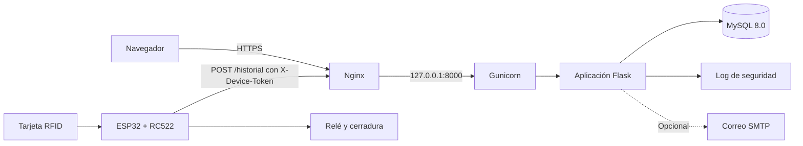

# Sistema de Control de Acceso RFID

[](https://github.com/AjaramilloRoldan/control_acceso/actions/workflows/ci.yml)


Plataforma web y firmware para administrar reservas y autorizar el ingreso físico a espacios de la Universidad Católica de Pereira mediante tarjetas RFID. Un lector ESP32 consulta al backend en cada lectura; el backend aplica las reglas de acceso, registra el intento en una bitácora auditable y responde si la cerradura debe liberarse.

Proyecto de grado del programa de Ingeniería de Sistemas y Telecomunicaciones.

## Contenido

- [Estado del proyecto](#estado-del-proyecto)
- [Funcionalidades](#funcionalidades)
- [Arquitectura](#arquitectura)
- [Estructura del repositorio](#estructura-del-repositorio)
- [Instalación local](#instalación-local)
- [Configuración](#configuración)
- [Pruebas](#pruebas)
- [Firmware](#firmware)
- [Despliegue en producción](#despliegue-en-producción)
- [Operación](#operación)
- [Seguridad](#seguridad)
- [Contrato de la API](#contrato-de-la-api)
- [Autores](#autores)

## Estado del proyecto

| Componente          | Estado                                                                                 |
| ------------------- | -------------------------------------------------------------------------------------- |
| Plataforma web      | Implementada y cubierta por pruebas automáticas e integración continua                 |
| Base de datos       | Modelo implementado en MySQL 8.0, con migraciones para instalaciones existentes        |
| Firmware            | Implementado; pendiente de ajustes de robustez y HTTPS, y de validación en hardware    |
| Despliegue          | Configuración incluida en `deploy/`; aún sin desplegar en un servidor institucional    |
| Requisitos medibles | Tiempos y disponibilidad pendientes de medir con el hardware y el servidor definitivos |

## Funcionalidades

**Comunidad universitaria**

- Consulta de espacios por capacidad, dotación y ubicación, con disponibilidad diaria.
- Solicitud, modificación y cancelación de reservas propias para estudiantes y docentes.
- Historial personal de accesos y bandeja de notificaciones.
- Aceptación versionada del aviso de privacidad.

**Administración**

- Gestión de usuarios, tarjetas RFID, espacios, políticas por rol y lectores.
- Programación recurrente de carga académica y franjas operativas, por formulario o CSV.
- Panel de métricas, monitoreo de lectores, reportes y exportación CSV.
- Bitácora consultable por fecha, espacio, usuario, resultado y motivo.

**Validación de acceso**

Cada lectura se evalúa en el servidor y queda registrada, autorizada o no, antes de responder al lector. Una falla al escribir en la bitácora deniega el acceso.

| Motivo                    | Condición                                                |
| ------------------------- | -------------------------------------------------------- |
| `TARJETA_NO_REGISTRADA`   | El UID no existe                                         |
| `TARJETA_REVOCADA`        | La tarjeta no está activa                                |
| `USUARIO_INACTIVO`        | El titular está inactivo                                 |
| `SIN_AUTORIZACION_DATOS`  | El titular no ha autorizado el tratamiento de datos      |
| `ESPACIO_NO_OPERATIVO`    | El espacio no admite el ingreso en su estado actual      |
| `ROL_NO_AUTORIZADO`       | La política del espacio excluye el rol del titular       |
| `SIN_RESERVA_VIGENTE`     | No hay reserva vigente, considerando el margen de acceso |
| `UID_INVALIDO`            | El UID recibido tiene un formato inválido                |
| `INSTALACION_NO_ASOCIADA` | El lector solicita validar otro espacio                  |
| `ERROR_REGISTRO`          | No fue posible persistir el intento                      |

## Arquitectura



| Capa         | Tecnología                                                       |
| ------------ | ---------------------------------------------------------------- |
| Backend      | Python 3.13, Flask 3.0, Flask-SQLAlchemy, mysql-connector-python |
| Interfaz     | Plantillas Jinja2, Tailwind CSS y JavaScript                     |
| Persistencia | MySQL 8.0 con InnoDB                                             |
| Seguridad    | bcrypt, Flask-WTF (CSRF), Flask-Limiter                          |
| Dispositivo  | ESP32, lector RC522, LCD I²C y relé                              |
| Producción   | Gunicorn detrás de Nginx con TLS                                 |

## Estructura del repositorio

```text
.
├── app.py                      # Punto de entrada
├── control_acceso/             # Paquete de la aplicación
│   ├── routes/                 # Blueprints por área funcional
│   ├── access.py               # Reglas de autorización física
│   ├── reservations.py         # Reglas de reservas y recurrencia
│   ├── permisos.py             # Respuestas ante rol no autorizado
│   ├── security.py             # Contraseñas, tokens y log de seguridad
│   └── ...
├── templates/                  # Vistas Jinja2
├── static/                     # Recursos estáticos
├── EjecutableHardware/         # Firmware del ESP32
├── deploy/                     # Gunicorn, systemd y Nginx
├── docs/openapi.json           # Contrato de las rutas JSON
├── tests/                      # Pruebas automáticas
├── migrate_*.py                # Migraciones para bases existentes
├── respaldar_base.py           # Respaldo verificado con retención
├── depurar_bitacora.py         # Depuración de la bitácora a 24 meses
├── monitor_disponibilidad.py   # Sondeo de /health
├── registrar_dispositivo.py    # Registro de lectores por consola
├── control_acceso.mwb          # Modelo de datos de MySQL Workbench
└── .env.example                # Plantilla de configuración
```

Los scripts `check_alejandro.py` y `check_timezone.py` son utilidades de diagnóstico. `inject_metrics.py` escribe valores históricos en `access_log`: no debe ejecutarse sobre datos reales.

## Instalación local

**Requisitos:** Python 3.13 y MySQL 8.0.

1. Clonar el repositorio y crear el entorno virtual.

   ```bash
   git clone https://github.com/AjaramilloRoldan/control_acceso.git
   cd control_acceso
   python -m venv venv
   ```

   Activarlo con `venv\Scripts\activate` en Windows o `source venv/bin/activate` en Linux y macOS.

2. Instalar las dependencias.

   ```bash
   pip install -r requirements.txt
   ```

3. Crear la configuración y generar una clave de sesión propia.

   ```bash
   cp .env.example .env
   ```

   ```bash
   python -c "import secrets; print(secrets.token_hex(32))"
   ```

   Guardar el resultado en `SECRET_KEY` y completar `DB_PASSWORD` en `.env`.

4. Crear la base de datos.

   ```sql
   CREATE DATABASE control_acceso CHARACTER SET utf8mb4;
   ```

5. Iniciar la aplicación. El primer arranque crea las tablas de los modelos.

   ```bash
   python app.py
   ```

   La aplicación queda en `http://localhost:5000` y escucha en todas las interfaces de red. Este modo es solo para desarrollo.

6. Crear el administrador inicial. La tabla `admin` no tiene modelo, por lo que el arranque no la crea. Primero se genera el hash de la contraseña:

   ```bash
   python -c "import bcrypt, getpass; print(bcrypt.hashpw(getpass.getpass().encode(), bcrypt.gensalt()).decode())"
   ```

   Después se ejecuta en MySQL, reemplazando el usuario y el hash:

   ```sql
   USE control_acceso;

   CREATE TABLE admin (
     id INT NOT NULL AUTO_INCREMENT,
     username VARCHAR(50) NOT NULL,
     password VARCHAR(255) NOT NULL,
     PRIMARY KEY (id)
   );

   INSERT INTO admin (username, password) VALUES ('NOMBRE_DE_USUARIO', 'HASH_GENERADO');
   ```

### Actualizar una instalación existente

Respaldar primero la base de datos y ejecutar únicamente las migraciones que falten:

```bash
python migrate_passwords.py
python migrate_access_log.py
python migrate_metricas.py
python migrate_modelo.py
python migrate_reservas.py
python migrate_notificaciones.py
python migrate_capacidad.py
python migrate_indices.py
```

## Configuración

`.env.example` es la plantilla de referencia. El archivo `.env` nunca debe subirse al repositorio.

| Variable                                                            | Obligatoria            | Valor por defecto        | Descripción                                                |
| ------------------------------------------------------------------- | ---------------------- | ------------------------ | ---------------------------------------------------------- |
| `SECRET_KEY`                                                        | Sí                     | —                        | Clave de firma de las sesiones                             |
| `DB_PASSWORD`                                                       | Sí, sin `DATABASE_URL` | —                        | Contraseña de MySQL                                        |
| `DB_HOST`                                                           | No                     | `localhost`              | Servidor de MySQL                                          |
| `DB_USER`                                                           | No                     | `root`                   | Usuario de MySQL                                           |
| `DB_NAME`                                                           | No                     | `control_acceso`         | Base de datos                                              |
| `DATABASE_URL`                                                      | No                     | —                        | URI completa; reemplaza las variables `DB_*` en SQLAlchemy |
| `FLASK_DEBUG`                                                       | No                     | `False`                  | Modo de depuración de `python app.py`                      |
| `BEHIND_HTTPS_PROXY`                                                | En producción          | `False`                  | Cookies seguras y confianza en `X-Forwarded-*`             |
| `MARGEN_ACCESO_MINUTOS`                                             | No                     | `10`                     | Anticipación permitida para ingresar a una reserva         |
| `PLAZO_MODIFICACION_MINUTOS`                                        | No                     | `60`                     | Antelación mínima para modificar o cancelar una reserva    |
| `SMTP_HOST`, `SMTP_PORT`, `SMTP_USER`, `SMTP_PASSWORD`, `SMTP_FROM` | No                     | Sin correo; puerto `587` | Envío de notificaciones por correo                         |
| `BACKUP_DIR`, `BACKUP_RETENTION_DAYS`, `MYSQLDUMP_PATH`             | Para respaldos         | Retención de `30` días   | Destino, retención y ruta de `mysqldump`                   |
| `HEALTH_URL`                                                        | No                     | `http://127.0.0.1:5000/health`                        | URL que sondea `monitor_disponibilidad.py`                 |

## Pruebas

```bash
pip install pytest==8.3.5 pyflakes==3.3.2
```

```bash
python -m pytest -q
```

Las pruebas usan SQLite y se detienen si detectan otro motor, para proteger la base real. La integración continua de GitHub Actions ejecuta análisis estático con `pyflakes`, la suite completa y la validación de la configuración de Gunicorn en cada pull request y en cada push a `main`.

## Firmware

El código está en `EjecutableHardware/EjecutableHardware.ino`.

| Componente | Conexión en el ESP32                   |
| ---------- | -------------------------------------- |
| RC522      | SS 5, RST 25, SCK 18, MISO 19, MOSI 23 |
| Relé       | GPIO 4                                 |
| LED        | GPIO 2                                 |
| LCD I²C    | Dirección `0x27`                       |

1. Instalar en Arduino IDE el soporte de ESP32 y las bibliotecas `MFRC522` y `LiquidCrystal_PCF8574`.
2. Registrar el lector en `/dispositivos` y copiar su token, que se muestra una sola vez.
3. Copiar `EjecutableHardware/secrets.example.h` como `EjecutableHardware/secrets.h` y completar la red, las URL y el token. Ese archivo está excluido de Git.
4. Ajustar `INSTALACION_ID` al identificador que muestra `/dispositivos` y cargar el firmware.

Un lector revocado recibe `401` desde su siguiente lectura. El registro también puede hacerse con `python registrar_dispositivo.py <id_instalacion> "<descripción>"`.

## Despliegue en producción

El despliegue previsto es Linux con Gunicorn detrás de Nginx, que termina TLS 1.2 o superior.

1. Copiar el proyecto en `/opt/control_acceso`, crear `venv` e instalar `requirements.txt`.
2. Definir en `.env` `FLASK_DEBUG=False`, una `SECRET_KEY` propia y `BEHIND_HTTPS_PROXY=True`.
3. Instalar `deploy/control-acceso.service` en `/etc/systemd/system/` y ejecutar `systemctl enable --now control-acceso`.
4. Adaptar `deploy/nginx.conf.example` con el dominio y obtener el certificado con Certbot.
5. Abrir solo los puertos 80 y 443 en el firewall.
6. Para medir disponibilidad, ejecutar el monitor con `HEALTH_URL=http://127.0.0.1:8000/health`.

Consideraciones obligatorias:

- Gunicorn debe escuchar solo en `127.0.0.1:8000`, porque la aplicación confía en las cabeceras del proxy.
- Se usa un solo proceso con varios hilos porque el límite de intentos se cuenta en memoria.
- Nginx redirige todo a HTTPS. El firmware actual usa `http://`: debe migrarse a `https://` con el certificado raíz antes de activar esa redirección.

## Operación

### Respaldos

`python respaldar_base.py` genera una copia comprimida en `BACKUP_DIR`, comprueba que esté completa y elimina las copias automáticas que superan `BACKUP_RETENTION_DAYS`, conservando siempre las 7 más recientes. Si falla, termina con código 1 y no toca las copias anteriores.

Debe programarse una vez al día para cumplir el RPO de 24 horas, con `BACKUP_DIR` fuera del disco del servidor:

```text
0 3 * * * cd /opt/control_acceso && venv/bin/python respaldar_base.py >> logs/respaldos.log 2>&1
```

Cada trimestre conviene restaurar una copia en una base de prueba y comparar los conteos de filas:

```bash
mysql -u root -p -e "CREATE DATABASE control_acceso_prueba"
```

```bash
gunzip -c control_acceso_AAAAMMDD_HHMMSS.sql.gz | mysql -u root -p control_acceso_prueba
```

### Depuración de la bitácora

La bitácora se conserva 24 meses. `python depurar_bitacora.py` solo informa cuántos registros vencieron; `python depurar_bitacora.py --aplicar` los elimina de forma definitiva. Debe ejecutarse una vez al mes, después de un respaldo.

### Aviso de privacidad

Cada usuario debe aceptar el aviso en su primer inicio de sesión. Sin esa autorización no entra a la plataforma y el lector lo deniega con `SIN_AUTORIZACION_DATOS`, aunque tenga reserva.

El texto está en `templates/autorizacion.html`. Al publicar un cambio, se debe subir `VERSION_AVISO` en `control_acceso/models.py`: la aceptación se solicita de nuevo en el siguiente inicio de sesión, sin bloquear las tarjetas mientras tanto.

### Disponibilidad y métricas

Con `python monitor_disponibilidad.py` en ejecución, el panel calcula la disponibilidad a partir de `/health`. Las métricas sin datos se muestran como `--`.

## Seguridad

| Control         | Implementación                                                                                |
| --------------- | --------------------------------------------------------------------------------------------- |
| Contraseñas     | Hash bcrypt; mínimo 12 caracteres con mayúsculas, minúsculas, dígitos y símbolos              |
| Sesiones        | Cookies firmadas `HttpOnly` y `SameSite=Lax`, y `Secure` detrás de HTTPS; vigencia de 8 horas |
| Autorización    | Verificación de rol por ruta; 403 y evento de seguridad ante un rol no autorizado             |
| Lectores        | Token individual almacenado como hash y revocable                                             |
| Formularios     | Protección CSRF con Flask-WTF                                                                 |
| Fuerza bruta    | 5 intentos de inicio de sesión cada 15 minutos por IP                                         |
| Inyección y XSS | Consultas parametrizadas, escape de Jinja2 y datos fuera de los manejadores en línea          |
| Cabeceras       | CSP, HSTS, `X-Frame-Options` y `X-Content-Type-Options`                                       |
| Trazabilidad    | Bitácora de accesos y `logs/security.log` con actor, evento e IP, con rotación                |
| Secretos        | Variables de entorno y `secrets.h`, excluidos de Git                                          |

**Limitaciones conocidas:** la CSP permite `unsafe-inline` porque las vistas usan scripts en línea, y las comunicaciones del firmware actual aún no están cifradas.

Las vulnerabilidades deben reportarse en privado a los autores, sin publicar detalles en un issue. Nunca se deben incluir credenciales reales, tokens de lectores ni respaldos de la base en commits, issues o pull requests.

## Contrato de la API

Las rutas JSON, incluidas las que usa el firmware, están documentadas en [`docs/openapi.json`](docs/openapi.json) con OpenAPI 3. Las pruebas fallan si una ruta `/api/` queda sin documentar.

| Ruta                                                                    | Método | Consumidor                   |
| ----------------------------------------------------------------------- | ------ | ---------------------------- |
| `/historial`                                                            | POST   | Lector: validación de acceso |
| `/api/metricas_acceso`                                                  | POST   | Lector: tiempos de lectura   |
| `/health`                                                               | GET    | Monitor de disponibilidad    |
| `/api/stats`, `/api/denegados`, `/api/monitoreo`                        | GET    | Panel de administración      |
| `/api/disponibilidad/{inst_id}/{fecha}`                                 | GET    | Calendario de reservas       |
| `/reservar`, `/reservas/{reserva_id}`, `/cancelar_reserva/{reserva_id}` | POST   | Gestión de reservas          |

## Autores

- **Alejandro Jaramillo Roldán**
- **Martín Salazar Escobar**

Director: Edwin Mauricio Sequeda Arenas. Universidad Católica de Pereira, Facultad de Ciencias Básicas e Ingeniería.

El repositorio no incluye licencia de uso; el código se publica con fines académicos y los derechos pertenecen a sus autores.
